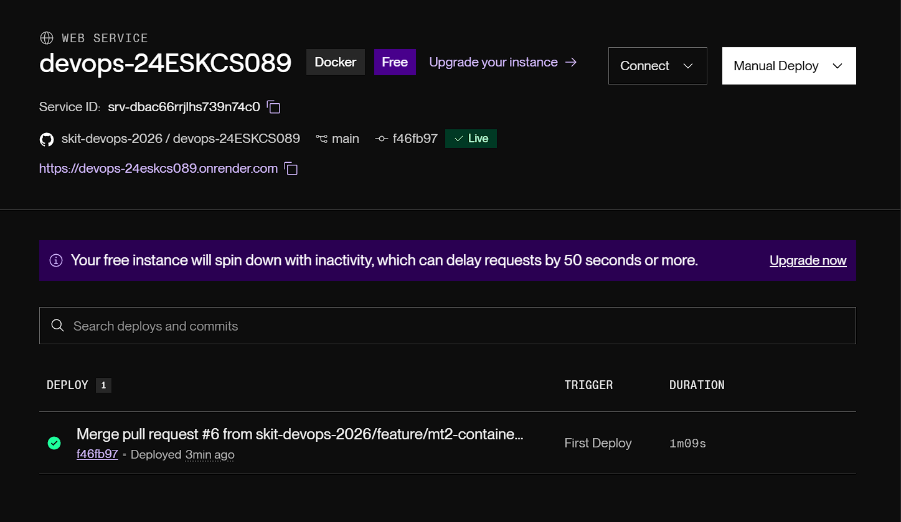

# Rescue-Network

## Author

| Roll No. | Name | GitHub username |
|---|---|---|
| 24ESKCS089 | Bhumika Goyal | bhumikagoyal014 |

## About

Food Rescue Network is a full-stack web application that connects donors
with NGOs and organizations that need useful resources. Users can donate
food, clothes, furniture, books, electronics, and other items, while NGOs
can browse available donations, request them, and coordinate pickup and
delivery through the platform.

## Tech stack

- Frontend: React.js
- Backend: Node.js / Express.js
- Database: MongoDB

## Running locally

```bash
make install
make run
```

## Live URL

https://devops-24eskcs089.onrender.com

## Health endpoint

`GET /health` returns the running commit SHA along with uptime, database status, and memory diagnostics. See `Makefile` and the milestone
sheet for why this is required.

---

# MT2 — Containerization, Deployment, Monitoring & Kubernetes

This section provides comprehensive documentation for Milestone 2 (MT2), covering Docker containerization, Docker Compose multi-service orchestration, Prometheus metrics and monitoring dashboards, GitHub Container Registry publication, Kubernetes manifests, and production deployment configuration.

---

## 1. Docker Setup

The application features a production-ready multi-stage [Dockerfile](file:///Dockerfile) utilizing official `node:20-alpine` images for lightweight, secure, and reproducible builds.

Key architectural highlights:
- **Multi-Stage Build**: First stage builds client frontend assets (`/app/client/dist`) using Vite; second stage packages Express server runtime and statically serves artifacts.
- **Minimal Footprint**: Uses `npm ci --omit=dev` in production runtime stage to eliminate development dependencies.
- **Non-Root Execution**: Runs under the unprivileged `node` user for security best practices.
- **Port Flexibility**: Configured to respect dynamic platform environment variables (`PORT`), defaulting to port `5000`.
- **Exclusions**: Clean [.dockerignore](file:///dockerignore) excludes `node_modules`, `.git`, `.env*`, build artifacts, and sensitive files.

In addition, individual component Dockerfiles are provided in [server/Dockerfile](file:///server/Dockerfile) and [client/Dockerfile](file:///client/Dockerfile) to support modular service builds.

---

## 2. Docker Build Command

To build the primary production application container image:

```bash
docker build -t devops-24eskcs089 .
```

To build individual sub-services (as defined in [Makefile](file:///Makefile)):

```bash
make docker-build
# Or manually:
docker build -t food-rescue-server ./server
docker build -t food-rescue-client ./client
```

---

## 3. Docker Compose Orchestration

The [docker-compose.yml](file:///docker-compose.yml) orchestrates the entire application and observability stack across an isolated bridge network (`rescue-net`):

| Service | Image / Build Context | Port Mapping | Description |
|---|---|---|---|
| `app` | Context: `.`, Dockerfile: `Dockerfile` | `5000:5000` | Rescue Network full-stack application |
| `mongodb` | `mongo:6.0` | `27017:27017` | Persistent MongoDB database storage |
| `prometheus` | `prom/prometheus:v2.51.0` | `9090:9090` | Time-series metrics scraper |
| `grafana` | `grafana/grafana:10.4.0` | `3000:3000` | Observability dashboard and visualization |

### Running the Stack

```bash
# Validate compose configuration
docker compose config

# Build and start services in the background
docker compose up -d

# View service logs
docker compose logs -f app

# Tear down stack and volumes
docker compose down -v
```

---

## 4. Published Container Registry Image

The container image is configured for automated build and publication to GitHub Container Registry (GHCR):

- **Image URL**: `ghcr.io/skit-devops-2026/devops-24eskcs089:latest`
- **Tagged Release**: `ghcr.io/skit-devops-2026/devops-24eskcs089:<commit-sha>`
- **Workflow**: Automated via [.github/workflows/ci.yml](file:///.github/workflows/ci.yml) upon push to `main` and feature branches using repository `GITHUB_TOKEN`.

---

## 5. Live Deployment

The application is deployed live on Render as a containerized web service.

- **Deployment Specification**: [render.yaml](file:///render.yaml) Infrastructure-as-Code Blueprint defining the Docker web service, health check path, port binding, and environment schema.
- **Configured Health Path**: `/health`
- **Dynamic Port**: Binds to `$PORT` environment variable provided by host environment.
- **Live URL**: https://devops-24eskcs089.onrender.com
- **Health Check URL**: https://devops-24eskcs089.onrender.com/health
- **Deployment Status**: Active and Live on Render (`Oregon` region).

### Deployment Verification Screenshot



---

## 6. Advanced Health Endpoint (`GET /health`)

Implemented in [server/server.js](file:///server/server.js) and verified via automated test suite.

- **URL**: `http://localhost:5000/health` (or `https://devops-24eskcs089.onrender.com/health`)
- **HTTP Method**: `GET`
- **Status Code**: `200 OK`
- **Payload**:
  ```json
  {
    "status": "ok",
    "commit": "f46fb97",
    "timestamp": "2026-10-18T13:10:00.000Z",
    "uptime": "120s",
    "environment": "production",
    "checks": {
      "database": {
        "status": "connected",
        "connected": true
      },
      "memory": {
        "heapUsedMB": 38.42,
        "heapTotalMB": 52.18,
        "rssMB": 74.65
      },
      "process": {
        "nodeVersion": "v20.x.x",
        "pid": 1
      }
    }
  }
  ```

---

## 7. Metrics Endpoint (`GET /metrics`)

The application exposes real-time Prometheus-compatible metrics implemented using `prom-client`:

- **URL**: `http://localhost:5000/metrics`
- **HTTP Method**: `GET`
- **Content-Type**: `text/plain; version=0.0.4; charset=utf-8`
- **Exported Metrics**:
  - `http_requests_total{method, route, status_code}`: Request counter across all API endpoints.
  - `http_request_duration_seconds{method, route, status_code, le}`: Histogram measuring request latency.
  - `food_rescue_process_cpu_seconds_total`: CPU consumption time series.
  - `food_rescue_process_resident_memory_bytes`: Memory RSS consumption.
  - `food_rescue_nodejs_heap_size_used_bytes`: V8 engine heap usage.
  - `food_rescue_nodejs_active_handles`: Active event loop handles.

---

## 8. Prometheus Setup

Prometheus is configured via [monitoring/prometheus.yml](file:///monitoring/prometheus.yml) with a 5-second scrape interval targeting the application container:

```yaml
scrape_configs:
  - job_name: "rescue-network-app"
    scrape_interval: 5s
    metrics_path: "/metrics"
    static_configs:
      - targets: ["app:5000"]
        labels:
          app: "rescue-network"
          environment: "production"
```

---

## 9. Monitoring Dashboard

A production Grafana dashboard is committed under [monitoring/grafana/dashboards/rescue-network-dashboard.json](file:///monitoring/grafana/dashboards/rescue-network-dashboard.json) (UID: `rescue-network-mt2`) and automatically provisioned via:
- [monitoring/grafana/provisioning/datasources/datasources.yml](file:///monitoring/grafana/provisioning/datasources/datasources.yml)
- [monitoring/grafana/provisioning/dashboards/dashboards.yml](file:///monitoring/grafana/provisioning/dashboards/dashboards.yml)

### Dashboard Panels Included:
1. **Service Status**: Visual UP/DOWN indicator (`up{job="rescue-network-app"}`).
2. **Total Request Rate (RPS)**: Real-time request volume.
3. **P95 Latency**: 95th-percentile response latency histogram quantile.
4. **Total Processed Requests**: Cumulative request counter.
5. **Request Rate by Route**: Traffic breakdown by endpoint.
6. **HTTP Status Codes Breakdown**: 2xx, 4xx, 5xx distribution.
7. **Node.js Process CPU Usage**: Real-time CPU percentage.
8. **Node.js Memory & Heap Usage**: Memory RSS, total heap, and used heap time series.

Full operational instructions are available in [monitoring/README.md](file:///monitoring/README.md).

---

## 10. Kubernetes Deployment

The manifest [k8s/deployment.yaml](file:///k8s/deployment.yaml) defines the declarative desired state for Kubernetes clusters:

- **Replicas**: 2 pods for high availability with rolling update strategy (`maxSurge: 1`, `maxUnavailable: 0`).
- **Container Image**: `ghcr.io/skit-devops-2026/devops-24eskcs089:latest`
- **Resource Management**:
  - CPU: `100m` request, `500m` limit
  - Memory: `128Mi` request, `512Mi` limit
- **Probes**:
  - `livenessProbe`: HTTP GET on `/health` (initialDelay: 15s, period: 10s)
  - `readinessProbe`: HTTP GET on `/health` (initialDelay: 10s, period: 5s)
- **Secrets Management**: Safe reference to `rescue-network-secrets` for `MONGODB_URI`.

---

## 11. Kubernetes Service

The manifest [k8s/service.yaml](file:///k8s/service.yaml) defines network exposure within the cluster:

- **Type**: `ClusterIP`
- **Port Mapping**: Service port `80` targeting container port `5000` (`TCP`).
- **Selector**: `app: rescue-network` matching pod template labels.

---

## 12. Verification Commands

To verify application health, metrics, and test suites locally:

```bash
# Run server test suite (including /health and /metrics tests)
cd server && npm test

# Build client production bundle
cd ../client && npm run build

# Validate repository hygiene checks
bash scripts/hygiene.sh

# Verify health endpoint locally
curl -i http://localhost:5000/health

# Verify metrics endpoint locally
curl -i http://localhost:5000/metrics

# Validate Kubernetes manifests (when kubectl is installed)
kubectl apply --dry-run=client -f k8s/
```

---

## 13. Required Environment Variables and Safe Configuration

| Variable | Required | Default | Description |
|---|---|---|---|
| `PORT` | No | `5000` | Port on which the HTTP server listens |
| `NODE_ENV` | No | `development` (`production` in containers) | Node runtime environment |
| `MONGODB_URI` | Yes (in prod) | — | MongoDB Atlas or container connection string |
| `JWT_SECRET` | Yes (for auth) | — | Secret key for signing authentication tokens |
| `GITHUB_SHA` | No | `local` | Commit hash returned by `/health` |

> **Security Note**: Never commit `.env` or production credentials to source control. Use Kubernetes Secrets or cloud hosting environment secrets.

---

## 14. Known Limitations & Manual Action Checklist

1. **Docker Daemon in Local Environment**: Docker Desktop is not installed locally on this host machine. All Docker files ([Dockerfile](file:///Dockerfile), [docker-compose.yml](file:///docker-compose.yml), `.dockerignore`) have been statically validated; container builds and GHCR image publishing are handled by the GitHub Actions CI pipeline ([.github/workflows/ci.yml](file:///.github/workflows/ci.yml)).
2. **Kubernetes Cluster**: Manifests ([k8s/deployment.yaml](file:///k8s/deployment.yaml), [k8s/service.yaml](file:///k8s/service.yaml)) are structurally verified and syntactically valid. Cluster deployment requires an active `kubectl` context.
3. **Live Hosting Platform Account**: Deployed live on Render at https://devops-24eskcs089.onrender.com. Proof of deployment is captured and committed under [docs/deployment-screenshot.png](file:///docs/deployment-screenshot.png).
